  
  
  
  
  

I build AI agents that do real work for people, and the safety rails that make them worth trusting: a yes before anything leaves, a receipt for every step, an Undo, and private details kept away from the model.

Right now that is **[Atlas Intelligent Workspace](https://atlasiw.com)**, one AI workspace for docs, sheets, boards, tasks, calendar and mail, and two open standards that came out of it. Before this, four years at TCS shipping LLM and NLP features for enterprise clients. MS in Applied AI at Northeastern.

More on my work is on my **[portfolio](https://portfolio-eta-gray-78.vercel.app)**, where you can skip the resume and ask an agent grounded in my projects.

## What I'm building

  
  
  
  

## Open source

| Package | What it does |
|---|---|
| [**Open Action Consent**](https://github.com/Ishan2036924/open-action-consent)     | A verifiable yes for actions AI agents take: the person signs the exact preview, the tool runs only if it matches, and every step leaves a signed receipt. Works next to MCP, A2A and AP2.   `pip install open-action-consent` · `npm i open-action-consent` |
| [**Open Pseudonym**](https://github.com/Ishan2036924/open-pseudonym)     | Swaps names, emails, dates and secrets for realistic stand-ins chosen for the task, so the model still does the job. Real values come back on your side, with a signed receipt of what left.   `pip install open-pseudonym` · `npm i open-pseudonym` |

## More projects

| Project | What it is |
|---|---|
| [Jarvis](https://github.com/Ishan2036924/Jarvis-Personal-AI-Agent) | A 24/7 personal assistant on OpenClaw, reached over Telegram: Gmail, Calendar, Notion, web search, voice and scheduled jobs. Notes on which models fake tool calls. |
| [OmegaTK Code Assistant](https://github.com/Ishan2036924/omega-tk-chatbot) | RAG code assistant for the OpenEye Omega Toolkit: intent routing, FAISS retrieval, AST and API checks with self-correcting retries. RAGAS 0.85, groundedness 1.00. |
| [UpMyRank](https://github.com/Ishan2036924/upmyrank-poc) | AI tutoring for JEE and NEET: a Socratic doubt engine, personalised practice and mock tests. Next.js, FastAPI, Supabase, pgvector. |
| [Findmejob](https://github.com/Ishan2036924/findmejob) | AI career platform: a candid profile check, verified job listings and a tailored resume and cover letter per job. |
| [Neural Express](https://github.com/Ishan2036924/Neural-Express) | AI news research and newsletter engine: 40+ feeds, duplicate and story-chain detection, ranking and summaries. |

## Writing

I write on [Medium](https://medium.com/@ishansri13) about agents, retrieval and what breaks in production.

<!-- medium:start -->
<table>
<tr><td><a href="https://medium.com/@ishansri13/jev-opus-5-5-gpt-6-sol-and-luna-the-week-llms-split-into-thinkers-and-deciders-37c8b68863c2"><b>Jev, Opus 5.5, GPT-6 Sol and Luna: the week LLMs split into thinkers and deciders</b></a></td><td align="right">Sep 2026</td></tr>
<tr><td><a href="https://medium.com/@ishansri13/rag-is-dead-influencer-fear-mongering-or-fact-the-enterprise-data-says-otherwise-5b2b590370e1"><b>“RAG Is Dead”: Influencer Fearmongering or Fact? The Enterprise Data Says Otherwise.</b></a></td><td align="right">Apr 2026</td></tr>
<tr><td><a href="https://medium.com/@ishansri13/anthropic-built-a-model-that-hacks-better-than-most-security-researchers-nobody-trained-it-to-d7377bdbbe30"><b>Anthropic Built a Model That Hacks Better Than Most Security Researchers. Nobody Trained It To.</b></a></td><td align="right">Apr 2026</td></tr>
</table>
<!-- medium:end -->

## Toolbox

Also: MCP, OpenAI and Anthropic APIs, LangGraph, pgvector, FAISS, RAGAS, Playwright, Cloudflare, Tailscale.

---

Boston, MA · <a href="https://portfolio-eta-gray-78.vercel.app">portfolio</a> · <a href="https://atlasiw.com">atlasiw.com</a> · Atlas on <a href="https://www.linkedin.com/company/atlas-intelligent-workspace/">LinkedIn</a> and <a href="https://www.instagram.com/atlas_workspace/">Instagram</a> · stats refresh daily

